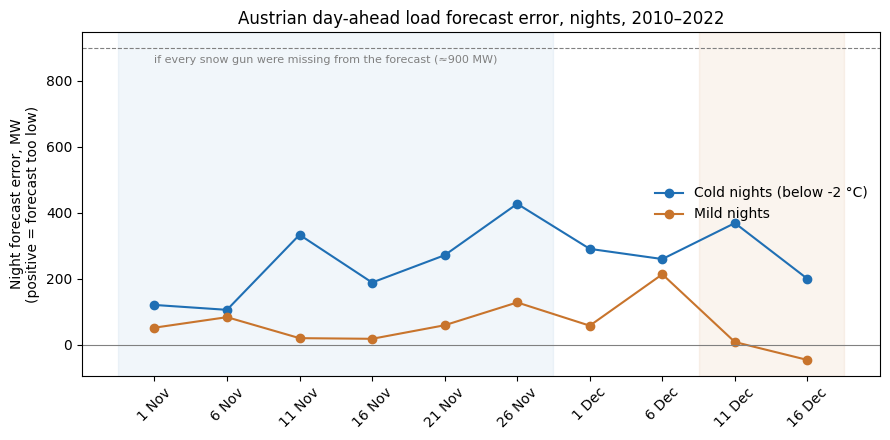

# Does Austria's electricity forecast miss snowmaking?

**In short:** Austria's day-ahead electricity forecast is too low on cold nights, by about 200 MW in November. But the gap does not fade by mid-December, when most snowmaking is over, so snowmaking does not explain it. Heating, or cold weather in general, is the likelier cause.

## 1. The question

Every afternoon, Austria's grid operator APG forecasts the next day's electricity use, hour by hour. The market and the grid plan with that forecast, and any error left on the day has to be balanced in real time, which costs money. For a power trader, forecast error is money.

Ski resorts make artificial snow on cold nights, mostly in November and early December. With every snow gun running, that is close to 900 MW, about a tenth of what Austria uses at night ([Aigner, Steiger & Mayer, 2026](https://www.tandfonline.com/doi/full/10.1080/09669582.2026.2656746)). If APG's forecast left this out, it would be too low on exactly those nights.

## 2. The idea of the test

A forecast that is too low on cold nights would not prove anything by itself, because cold nights also mean more heating. What only snowmaking does is fade during the season: resorts build their snow base in November and have mostly finished by mid-December. Heating does not fade like that.

So I compare the forecast error on cold nights with mild nights twice:

- in **November**, when many snow guns run on a cold night;
- on **11–20 December**, when far fewer do.

If the forecast missed snowmaking, the cold-night gap would be much bigger in November than in mid-December. I stop on 20 December because the Christmas shutdown of industry changes the forecast error by itself from the 21st.

## 3. Data

- **Electricity:** APG's actual load and day-ahead forecast, 2010–2022, published free as 15-minute values. I average them to hours and drop 92 broken hours (load or forecast below 3,000 MW), leaving 113,847.
- **Temperature:** hourly air temperature from GeoSphere Austria at the three highest stations in Tyrol and in Salzburg, the two states with most of the big ski areas: Ischgl-Idalpe, Rudolfshütte, Patscherkofel, Galzig, Mooserboden and Schmittenhöhe (1,956 to 2,327 m).

## 4. Method

1. **Nights, not hours.** Snow guns run at night, so I average the forecast error over 20:00–06:59 for each night. The 11 hours of one night are almost copies of each other, so treating them as separate observations would overstate the precision.
2. **Cold or mild.** A night is cold when the six stations average below −2 °C, about where snow guns can start.
3. **Two windows.** 387 nights in November and 129 on 11–20 December, over 13 winters; 1–10 December is left out as in between.
4. **Regression.** `error = cold + cold × december + winter + weekday`. The `cold` term is the November gap, `cold × december` is how much it changes by mid-December (the snowmaking test), and the winter and weekday terms make sure nights are compared with nights of the same winter and the same day of the week.
5. **Uncertainty.** The ranges are 95% and allow nights in the same week to be related, which makes them wider and more honest.

## 5. Results

| | Gap, cold vs mild nights | 95% range |
|---|---|---|
| November | +206 MW | ± 100 |
| 11–20 December | +344 MW | ± 198 |
| Change by mid-December | +137 MW (p = 0.25) | ± 236 |

## 6. What it means

- **The forecast does run low on cold nights.** In November the gap is about 200 MW, clearly different from zero.
- **It is not snowmaking.** If it were, the gap would shrink by mid-December. It does not; if anything it grows, although that difference could be chance (p = 0.25). Whatever the forecast misses on cold nights stays with the cold, not with the snowmaking season.
- **How strong is the "no"?** The test would reliably find a change of about 340 MW or more. So it rules out the forecast missing most of the 900 MW, but it could miss a smaller snowmaking effect.

## 7. Limits

- Six weather stations stand in for every ski area in Austria.
- Snow guns depend on humidity as well as temperature (the "wet bulb"); I use air temperature only.
- Some resorts keep making snow in December. That would shrink the November–December difference and make the "no" less convincing.
- This is APG's published day-ahead forecast. It says nothing about the forecasts traders build themselves, which may already correct for cold nights.

## How to run it

Open the notebook with the Colab button above and click **Runtime → Run all**. It downloads everything itself, needs no account, and takes about five minutes.

## Reference

Aigner, Steiger & Mayer (2026). *Snowmaking in Austria: resource consumption and greenhouse gas emissions.* Journal of Sustainable Tourism. [Article](https://www.tandfonline.com/doi/full/10.1080/09669582.2026.2656746)
